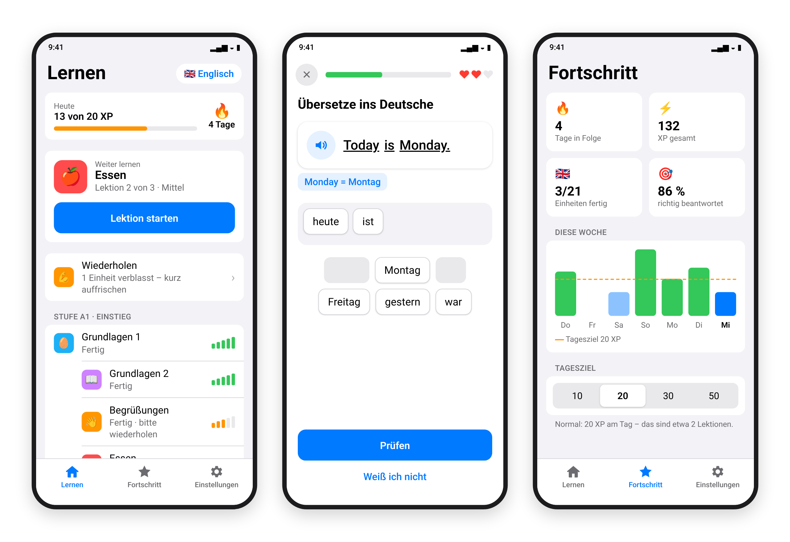
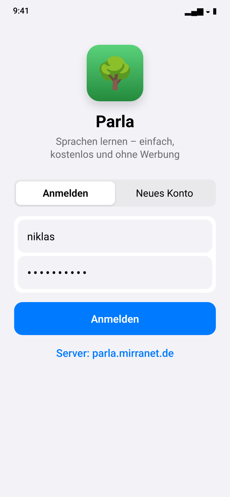
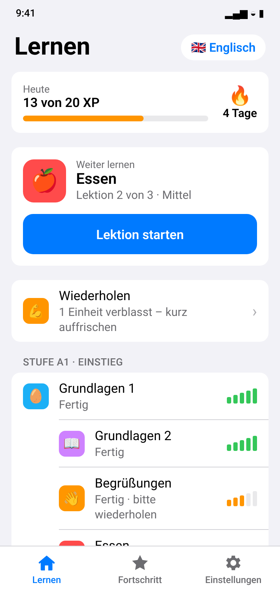
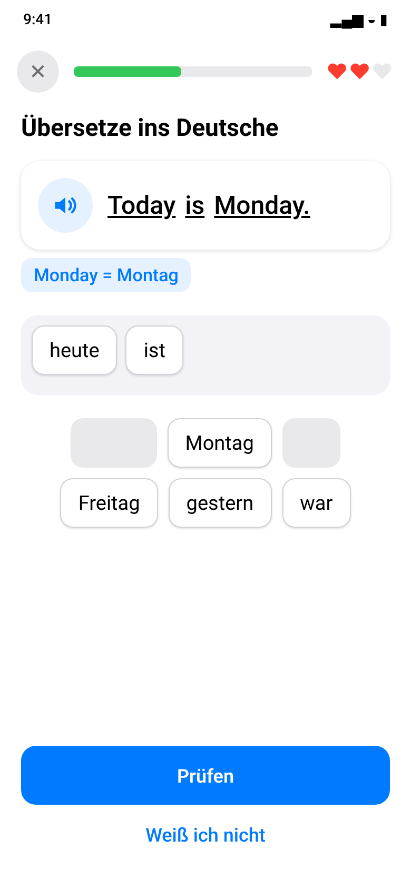
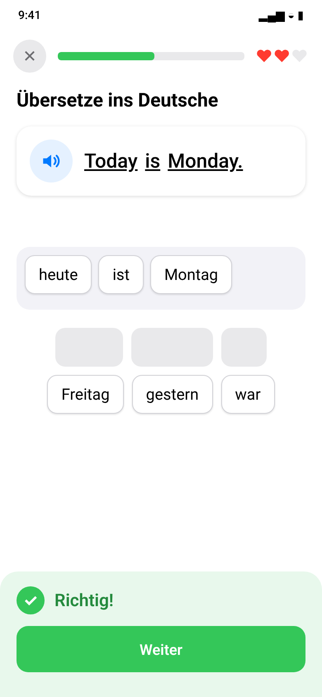
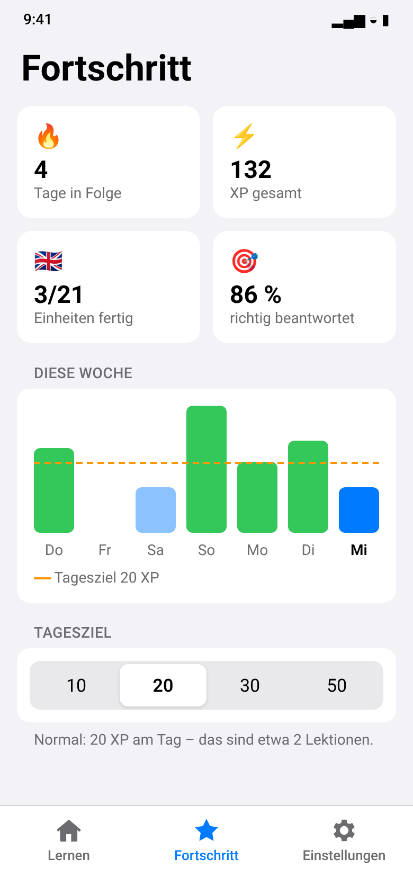
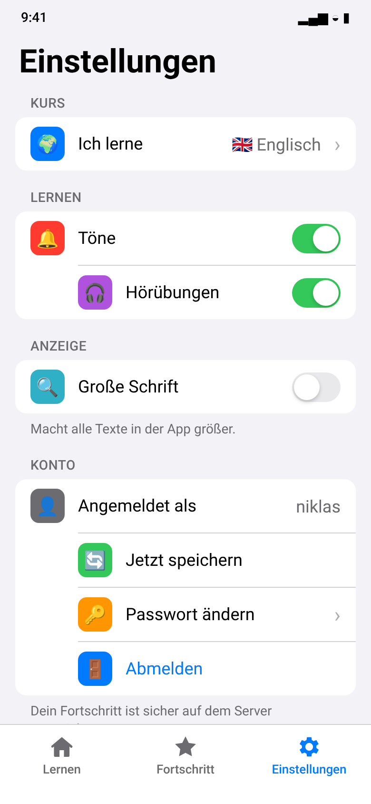

# Parla

A calm, simple language learning app for Android, Linux and Windows: units grouped by level, short lessons with three hearts, and strength
bars that fade and ask for review – and nothing else. No ads, no gems, no leagues.

The first courses are **English** and **French** for German speakers, each with 21 units from A1 to B1
(numbers, colours, time, weather, city, questions, restaurant, free time, past and future tense, travel, work …).



| Anmelden | Lernen | Übung |
|:---:|:---:|:---:|
|  |  |  |
| **Rückmeldung** | **Fortschritt** | **Einstellungen** |
|  |  |  |

<sub>Design previews rendered from the app's colours, type scale and layout; screenshots from a real device may differ in small details.</sub>

```
parla/
├── shared/            Lesson engine + data layer (plain Kotlin), used by both apps
├── android/           Android app (Kotlin + Jetpack Compose)
├── desktop/           Desktop app for Linux and Windows (Kotlin + Compose Multiplatform)
├── docs/screenshots/  Images for this README
└── Jenkinsfile        Builds the APK, the .deb and (with a Windows agent) the .msi
```

The backend (accounts, course files, progress sync) lives in
**[Parla-Studio/parla-server](https://github.com/Parla-Studio/parla-server)** – it also holds the course content and its format.

## How it fits together

* **Content comes from the server.** The app ships without any lessons. On every start and whenever it returns to
  the foreground it asks the server for the course list hash; only courses whose hash changed are downloaded and
  cached for offline use. Editing a file in the server's content folder is enough – no app update, no server restart.
* **Accounts.** Username + password; the app can change the password and delete the account.
* **Adaptive difficulty.** Every finished session reports how many answers were right. The server keeps a running
  accuracy per skill (an exponential moving average). From it the app derives a difficulty between 0 and 1. A new
  skill also takes the learner's results in the rest of the course into account. Low difficulty means more
  recognition: word banks into German, multiple choice with clearly wrong options, few chips, little review.
  High difficulty means new sentences often skip the recognition step, with more free typing and listening, chips
  with look-alike words from the same unit, confusable options and more review. Inside a session, two mistakes
  in a row make the next exercises easier, and four correct answers in a row make them harder.
* **Progress sync.** Finishing a lesson creates an event with a random id. Events are applied locally right away
  (works offline) and uploaded in the background. The server applies each id at most once, so retries are safe,
  and returns the authoritative progress snapshot.

## Android app

The interface follows an iOS-like look that is meant to be easy for people who rarely use a phone: grouped
lists on a light grey background, large text and 56 dp touch targets, a bottom tab bar (Lernen · Fortschritt ·
Einstellungen), one big "Lektion starten" button for the next lesson, plain-language messages, and an optional
"Große Schrift" switch that enlarges all text by 20 % on top of the system setting.

Open `android/` in Android Studio, or build from the command line (needs a JDK 17+, `unzip` and `curl`/`wget`):

```bash
cd android
scripts/setup-android-sdk.sh > .build-env && . ./.build-env   # JDK + Android SDK, installed on first run
./gradlew testDebugUnitTest assembleRelease
```

`setup-android-sdk.sh` reuses an existing SDK if `ANDROID_HOME` is set, accepts the SDK licences and installs
platform 35 and build tools 35.0.0. Gradle 8 cannot run on Java 25+, so if the machine's Java is outside 17–24
the script downloads a Temurin JDK 21 into `~/jdks/temurin-21` and uses it for the Android build only. Jenkins runs it automatically. The APK ends up in
`android/app/build/outputs/apk/release/Parla-<version>-release.apk`.

The default server address comes from `parlaServer` in `android/gradle.properties`
(`https://parla.mirranet.de`) and can be changed on the login screen. Debug builds also allow plain HTTP,
e.g. `http://10.0.2.2:8085` for a server on the emulator's host.

The release build is signed with the debug key so it installs out of the box. For a real release, add your own
`signingConfig` in `android/app/build.gradle.kts`.

## Desktop app (Linux, Windows)

A native desktop version built with Compose Multiplatform. It shares the lesson engine, the API client and the
offline store with the Android app (`shared/`) and uses the same screens, adapted for a big screen and a keyboard:

* a sidebar instead of the bottom tab bar, content centred at a readable width, unit details in a dialog;
* keyboard: **Enter** checks and continues, **1–9** picks an answer, **Esc** leaves a lesson or closes a dialog,
  **Ctrl+1/2/3** switches between Lernen, Fortschritt and Einstellungen;
* speech output through the system: Windows speech (System.Speech, install voices under *Zeit und Sprache →
  Sprache*), on Linux `spd-say` (speech-dispatcher) or `espeak-ng`;
* progress syncs at start, every five minutes and whenever the window gets focus, so it picks up where the phone
  left off. The same account works on all devices.

Data lives in `%APPDATA%\Parla` on Windows and `~/.local/share/parla` on Linux (the login token is stored
there with owner-only permissions).

Build (needs a JDK 17–21; `setup-jdk.sh` downloads Temurin 21 if the system Java does not fit):

```bash
cd desktop
scripts/setup-jdk.sh > .build-env && . ./.build-env
./gradlew run          # start the app
./gradlew distDeb      # Linux:   build/dist/Parla-<version>-linux.deb   (needs dpkg-deb + fakeroot)
```

On Windows: `gradlew.bat distMsi` → `build\dist\Parla-<version>-windows.msi` (per-user install, Start menu
and desktop shortcut; WiX is downloaded by the build). Installers bundle their own Java runtime, so users need
nothing else. jpackage cannot cross-build, so the .msi has to be built on Windows: in Jenkins, set
`PARLA_WINDOWS_AGENT` to the label of a Windows agent to enable that stage.

The version number lives in `desktop/build.gradle.kts` (keep it in step with Android), the default server in
`desktop/gradle.properties`.

## Tests

The engine and data layer live in `shared/` and are tested through the Android unit tests: `EngineTest` runs the lesson engine against the real course files (test copies in
`android/app/src/test/resources/courses`, taken from parla-server) and checks that every generated exercise is
solvable, that difficulty follows accuracy and that local progress rules match the server.
